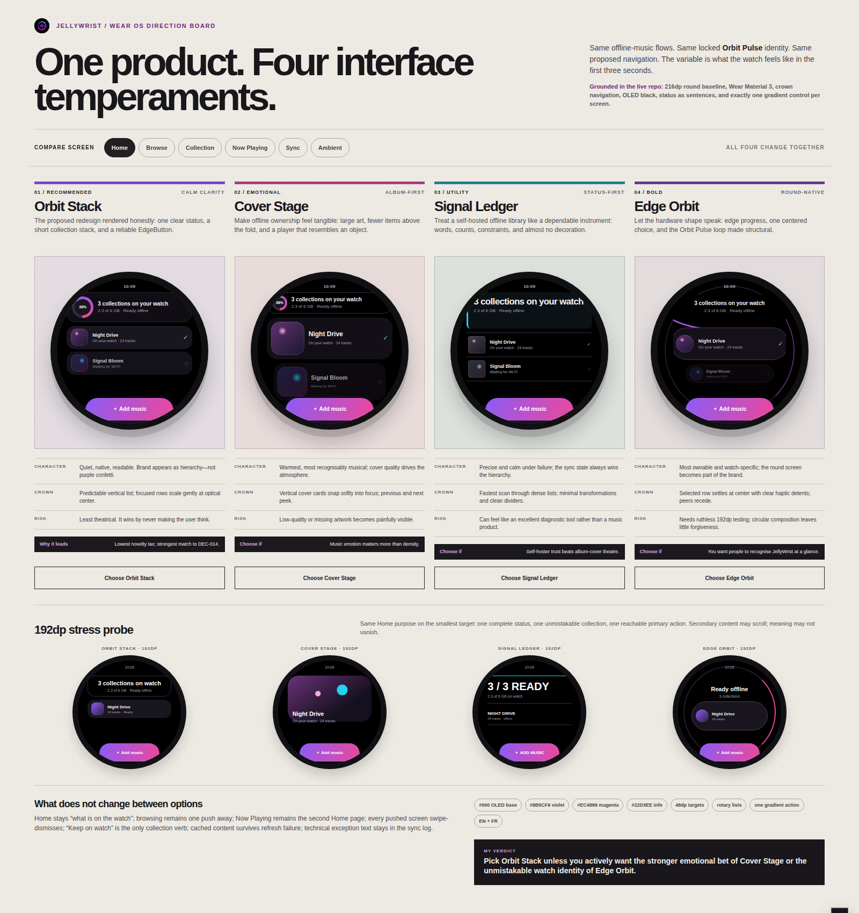

# Wear OS UI direction board

This directory contains a disposable comparison artifact for the proposed JellyWrist watch UI redesign. It helps the owner select the interface temperament before DEC-014 is approved and before any production implementation begins.

Open `index.html` in a modern browser. The screen controls switch all four watches together between:

- Home
- Browse
- Collection
- Now Playing
- Sync
- Ambient

A query parameter can open a state directly, for example `index.html?screen=sync`.

## Directions

1. **Orbit Stack — recommended:** calm hierarchy and the most direct expression of the proposed redesign.
2. **Cover Stage:** album-art-first and emotionally musical.
3. **Signal Ledger:** state, capacity, and operational certainty first.
4. **Edge Orbit:** circular, rotary-centred composition with the strongest watch-specific identity.

## Fixed baseline

The board varies visual composition, not product behaviour. All four directions retain the proposed DEC-014 information architecture, the Orbit Pulse identity, Aurora colours and typography, Wear Compose Material 3, swipe-dismiss navigation, rotary-first vertical lists, the single **Keep on watch** vocabulary, and offline-first behaviour.

The four compact watches below the main comparison are explicit 192dp stress probes. Ambient screens remove energetic colour and nonessential detail.

## Decision boundary

This artifact is not an implementation plan and does not approve DEC-014. Production work still requires the owner's direction selection, an implementation plan, and explicit approval to execute that plan.
